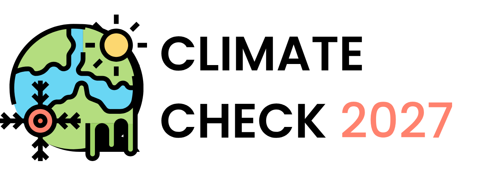

 

 
<h1>Shared Task on Cross-Lingual Scientific Fact-Checking of Social Media Claims about Climate Change</h1>

Social media claims about climate change appear across languages, yet scientific fact-checking resources, including previous ClimateCheck iterations (Abu Ahmad et al., 2025, 2026), have largely paired claims and evidence only within English. 

ClimateCheck 2027 introduces a cross-lingual setting: given a claim in German or Arabic, systems must retrieve supporting or refuting evidence from English-language environmental-science abstracts. The languages span different language families and scripts, enabling evaluation of cross-lingual retrieval and evidence grounding. Claims will be derived from previous English ClimateCheck datasets and validated by native speakers. The task extends prior work on cross-lingual claim matching (Huang et al., 2022) and multilingual claim–evidence pairing (Vladika et al., 2024) to scientific-paper evidence retrieval.

More information on data, requirements, and timeline will be announced soon. 

## Shared task organisers:

* <a href="mailto:raia.abu_ahmad@dfki.de">Raia Abu Ahmad (DFKI Berlin)</a>
* <a href="mailto:georg.rehm@dfki.de">Georg Rehm (DFKI Berlin)</a>

## References and further reading:
* Abu Ahmad, R., Usmanova, A., & Rehm, G. (2025, July). [The ClimateCheck shared task: Scientific fact-checking of social media claims about climate change](https://aclanthology.org/2025.sdp-1.24.pdf). In Proceedings of the Fifth Workshop on Scholarly Document Processing (SDP 2025) (pp. 263-275).
* Abu Ahmad, R., Usmanova, A., & Rehm, G. (2025, July). [The ClimateCheck dataset: Mapping social media claims about climate change to corresponding scholarly articles](https://aclanthology.org/2025.sdp-1.5.pdf). In Proceedings of the Fifth Workshop on Scholarly Document Processing (SDP 2025) (pp. 42-56).
* Abu Ahmad, R., Upravitelev, M., Usmanova, A., Solopova, V. and Rehm, G., 2026. [ClimateCheck 2026: Scientific Fact-Checking and Disinformation Narrative Classification of Climate-related Claims](https://aclanthology.org/2026.nslp-1.pdf#page=61). Natural Scientific Language Processing (NSLP 2026)@ LREC 2026, p.49.
* Huang, K.H., Zhai, C. and Ji, H., 2022, October. [CONCRETE: Improving cross-lingual fact-checking with cross-lingual retrieval](https://aclanthology.org/2022.coling-1.86.pdf). In Proceedings of the 29th International Conference on Computational Linguistics (pp. 1024-1035).
* Vladika, J., Schneider, P. and Matthes, F., 2024, May. [HealthFC: Verifying health claims with evidence-based medical fact-checking](https://aclanthology.org/2024.lrec-main.709.pdf). In Proceedings of the 2024 Joint International Conference on Computational Linguistics, Language Resources and Evaluation (LREC-COLING 2024) (pp. 8095-8107).
